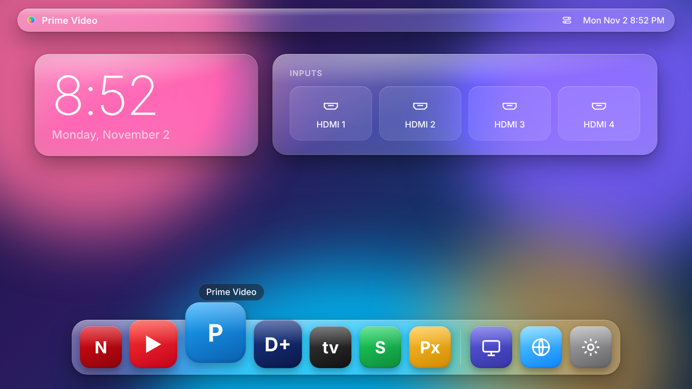

# TV Hub

A macOS-inspired **"liquid glass"** home screen for smart TVs. The first app here is
**Glass Launcher** for LG webOS: a frosted-glass menu bar, clock and input widgets, a
magnifying dock, and a Control Center panel — all driven by the TV remote.



## Contents

- [`tv-launcher/`](tv-launcher/) — Glass Launcher, an installable LG webOS app.
  See [`tv-launcher/README.md`](tv-launcher/README.md) for install and customisation steps.

## Quick preview

Open `tv-launcher/index.html` in Chrome. Arrow keys move, Enter selects, Esc is Back.
In a browser, launching an app shows a message instead of opening it; on the TV it opens
the real app.

## Install on an LG TV (short version)

1. Install **Developer Mode** on the TV from the LG Content Store and sign in with a free
   LG developer account.
2. On a computer on the same network:
   ```sh
   npm install -g @webos-tools/cli
   ares-setup-device
   ares-package tv-launcher
   ares-install --device tv house.hueco.glasslauncher_1.0.0_all.ipk
   ```

Full steps, limits, and customisation are in [`tv-launcher/README.md`](tv-launcher/README.md).
