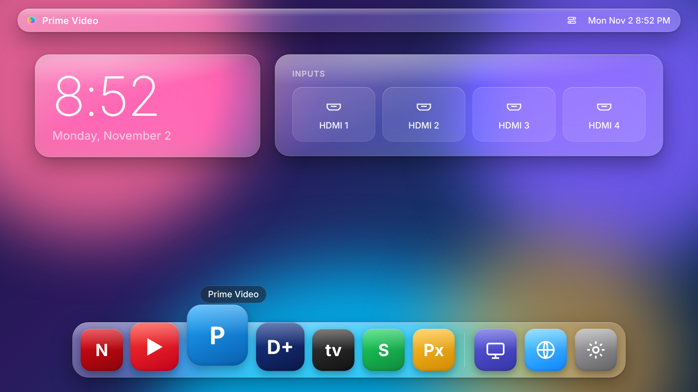

# Glass Launcher (LG webOS)

A macOS-inspired "liquid glass" home screen for LG webOS TVs: frosted-glass menu bar,
clock and inputs widgets, a magnifying dock, and a Control Center panel. It works with
the arrow keys on the remote and with the Magic Remote pointer.



## Preview in a browser

Open `index.html` in Chrome. Use the arrow keys to move, Enter to select, and Esc for Back.
In the browser, launching an app shows a "Would open …" message instead of opening it.

## Install on the TV

1. On the TV, install **Developer Mode** from the LG Content Store. Sign in with a free
   LG developer account (https://webostv.developer.lge.com), then turn on **Dev Mode Status**
   and **Key Server**. Note the TV's IP address and passphrase.
2. On a computer on the same Wi-Fi network:
   ```sh
   npm install -g @webos-tools/cli
   ares-setup-device                          # add the TV: name "tv", its IP, port 9922
   ares-novacom --device tv --getkey          # enter the passphrase shown on the TV
   ares-package tv-launcher                   # creates house.hueco.glasslauncher_1.0.0_all.ipk
   ares-install --device tv house.hueco.glasslauncher_1.0.0_all.ipk
   ares-launch --device tv house.hueco.glasslauncher
   ```
3. The app appears as **Glass** in your app list. Pin it first in the LG home bar.

Dev Mode installs expire after 50 hours unless you renew the session in the Developer Mode app.

## Customise

- **Dock apps:** edit `FAVORITES` in `js/launcher.js`. List your TV's app IDs with
  `ares-launch --device tv --running` or `ares-install --device tv --list`.
- **Wallpaper colours:** the `.b1`–`.b4` blobs in `css/glass.css`.
- **Glass strength:** the `backdrop-filter` and `--glass-fill` settings in `css/glass.css`.

## Limits

- This is an app that runs on top of webOS. It doesn't replace LG's own home screen. To make it
  open automatically at power-on, the TV must be rooted (webOS Homebrew Channel). Rooting
  depends on your model and firmware and isn't required to use the app.
- On older TVs (webOS 4.x and earlier) without blur support, the glass falls back to solid
  frosted panels. If animations stutter, turn them off under Control Center → Animations.
- Some firmware blocks apps from listing installed apps. In that case the dock shows the
  default list from `FAVORITES`.
